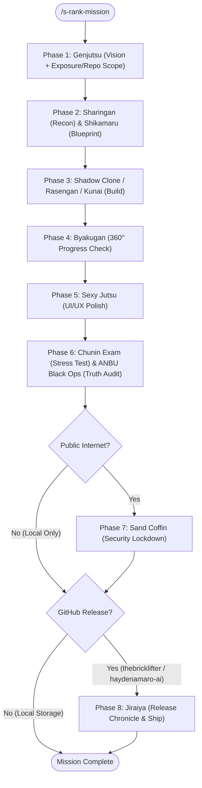

# 🍥 Shinobi Arsenal: Naruto-Themed Antigravity Skills

A complete, end-to-end tactical suite of **15 custom agent skills (Jutsus)** for Google Antigravity, engineered to guide software projects from initial Socratic discovery and Kakashi-style domain mentorship through parallel execution, autonomous debugging, visual polish, security hardening, and release chronicle packaging.

---

## 📜 The 15-Jutsu Arsenal

### 🧭 Discovery, Planning, Reconnaissance & Mentorship
| Skill | Invoke Command | Role & Purpose |
| :--- | :--- | :--- |
| **[`s-rank-mission`](.agents/skills/s-rank-mission/SKILL.md)** | `/s-rank-mission` | **Master End-to-End Orchestrator:** Kicks off a full project lifecycle starting with Genjutsu to lock in user outcomes, exposure scope (Local vs. Public Internet), and release destination (`Local Machine` vs. `Personal GitHub: thebricklifter` vs. `Work GitHub: haydenamaro-ai`), then dynamically sequences the entire Shinobi pipeline. |
| **[`genjutsu`](.agents/skills/genjutsu/SKILL.md)** | `/genjutsu` | **Socratic Product Sparring Partner:** Interactive, single-question interrogation focused strictly on human behavior, user outcomes, failure recovery, and deployment/repository scope before a single line of code is written. Released with `"Kai"`. |
| **[`sharingan`](.agents/skills/sharingan/SKILL.md)** | `/sharingan` | **Technical Reconnaissance & Pattern Copy:** Researches how top engineering teams solve complex technical hurdles, synthesizes a composite strategy blueprint, and includes an educational plain-English breakdown. |
| **[`kakashi-sensei`](.agents/skills/kakashi-sensei/SKILL.md)** | `/kakashi-sensei` | **The Copy Ninja Mentor & Domain Educator:** Teaches the user about whatever problem area, algorithm, or system architecture we are currently working on—speaking in Kakashi Hatake's laid-back, perceptive voice while peeling back "underneath the underneath" with mental models and a Bell Test. |
| **[`shikamaru`](.agents/skills/shikamaru/SKILL.md)** | `/shikamaru` | **200-IQ Strategic Architect:** Maps the critical path, discovers clever architectural shortcuts, and produces phased execution checklists (`- [ ]`) ready for Shadow Clone dispatch and Byakugan tracking. |

### ⚡ Execution, Swarm & Debugging
| Skill | Invoke Command | Role & Purpose |
| :--- | :--- | :--- |
| **[`shadow-clone`](.agents/skills/shadow-clone/SKILL.md)** | `/shadow-clone` | **Horizontal Multi-Agent Swarm:** Decomposes broad features across named parallel specialist sub-agents, anticipates downstream bottlenecks 2–3 steps ahead, and consolidates deliverables. |
| **[`rasengan`](.agents/skills/rasengan/SKILL.md)** | `/rasengan` | **Autonomous Vertical Problem Finisher:** Locks onto a single stubborn bug, broken pipeline, or failing test suite and iterates relentlessly until the binary passing criteria are satisfied, followed by a Dawn Debrief. |
| **[`kunai`](.agents/skills/kunai/SKILL.md)** | `/kunai` | **Rapid-Fire Tactical Micro-Fixes:** Executes zero-ceremony, surgical diffs (`< 5 lines`) for single bugs or punch-list volleys and reports back with a 3-line Cause / Action / Status debrief. |

### 👁️ Visibility, Polish & Verification
| Skill | Invoke Command | Role & Purpose |
| :--- | :--- | :--- |
| **[`byakugan`](.agents/skills/byakugan/SKILL.md)** | `/byakugan` | **360° Executive Operational Visibility:** Audits conversation history, user checklists, and Shikamaru roadmaps to compute exact weighted completion percentages and surface hidden bottlenecks. |
| **[`sexy-jutsu`](.agents/skills/sexy-jutsu/SKILL.md)** | `/sexy-jutsu` | **Visual QA & UI/UX Transformation:** Steps through live user flows, captures before/after visual evidence, audits information hierarchy and copy clarity, and polishes spacing, typography, and micro-interactions. |
| **[`chunin-exam`](.agents/skills/chunin-exam/SKILL.md)** | `/chunin-exam` | **Competency & Stress Testing:** Subjects features to boundary torture, adversarial inputs, AI prompt adherence grading, and latency benchmarks before shipping. |
| **[`anbu-black-ops`](.agents/skills/anbu-black-ops/SKILL.md)** | `/anbu-black-ops` | **Internal Affairs & Truth Verification:** Audits agent work for hardcoded hacks, hollow stubs, disabled assertions, phantom dependencies, and secret/credential leakage. |

### 🛡️ Perimeter Lockdown, Release & Reference
| Skill | Invoke Command | Role & Purpose |
| :--- | :--- | :--- |
| **[`sand-coffin`](.agents/skills/sand-coffin/SKILL.md)** | `/sand-coffin` | **Internet-Facing Security Hardening:** Enforces zero-trust input sanitization, IDOR ownership checks, response pruning, rate limiting, and defensive HTTP headers prior to public deployment. |
| **[`jiraiya`](.agents/skills/jiraiya/SKILL.md)** | `/jiraiya` | **The Master Author & GitHub Ship:** Sanitizes the workspace, verifies the target GitHub identity (`Personal: thebricklifter` vs. `Work: haydenamaro-ai`), crafts conventional commits, and writes a human-readable Grand Release Chronicle. |
| **[`ninja-scroll`](.agents/skills/ninja-scroll/SKILL.md)** | `/ninja-scroll` | **Interactive Jutsu Directory:** Scans workspace and global skill directories and presents a categorized tactical command card and pipeline map. |

---

## 🔄 The S-Rank Mission Pipeline



---

## 🚀 Installation & Global Sync

### Workspace-Level Discovery
Place the `.agents/skills/` directory at the root of any Antigravity workspace:
```bash
.agents/skills/<skill-name>/SKILL.md
```

### Global Machine-Level Discovery
Sync all 15 skills to your global Antigravity configuration so they are available across every project on your machine:
```bash
mkdir -p ~/.gemini/config/skills
cp -R .agents/skills/* ~/.gemini/config/skills/
```
